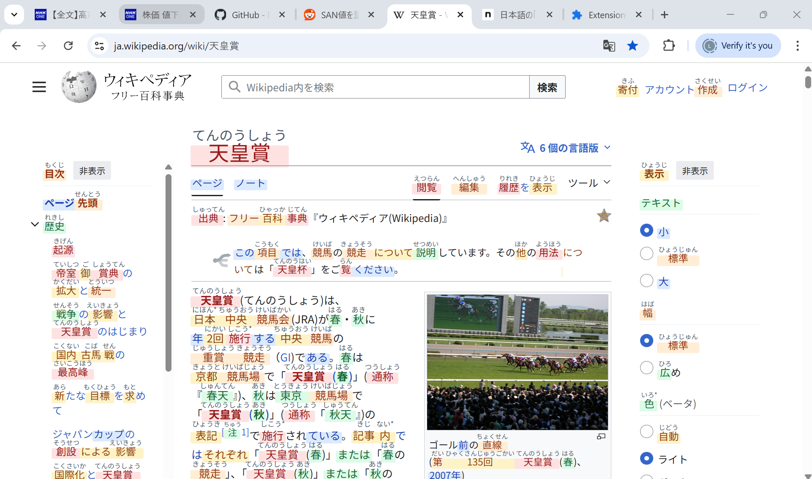
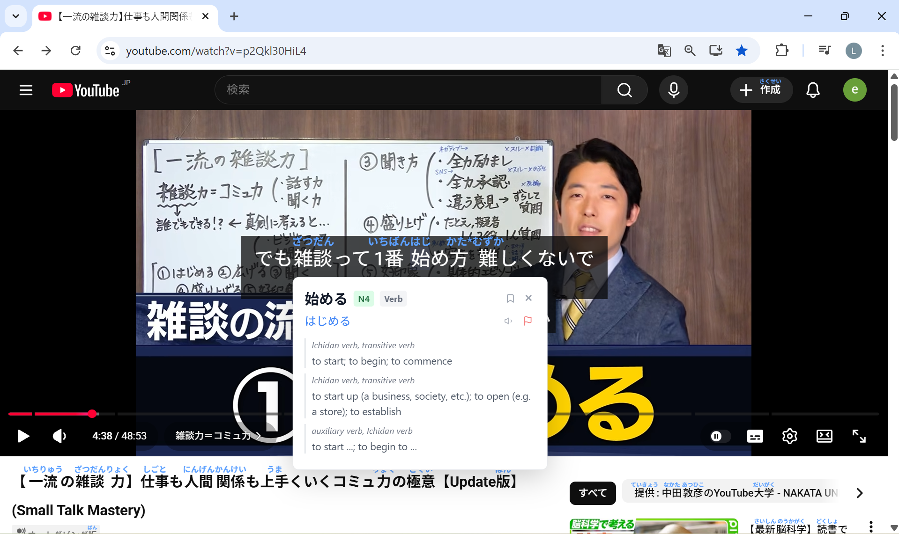
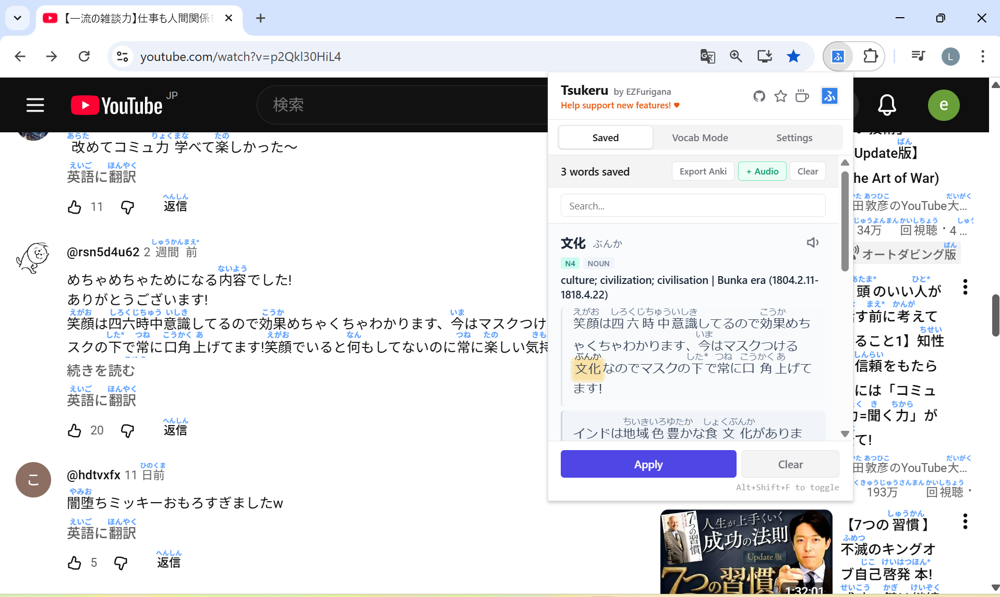
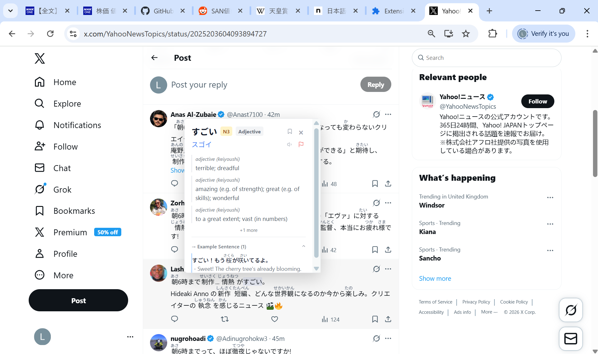

<div align="center">
  
  <h1>Tsukeru</h1>
  <p>Furigana and dictionary tools for Japanese webpages.</p>
  <p>
    <a href="https://chromewebstore.google.com/detail/tsukeru-for-ezfurigana/lmfkndmjigoadbmidhlenapakagnbkpc">Chrome Web Store</a> ·
    <a href="https://microsoftedge.microsoft.com/addons/detail/tsukeru-for-ezfurigana/cdlcehkdgoaboeapgjdhnklgicmiknia">Edge Add-ons</a> ·
    <a href="https://addons.mozilla.org/en-US/firefox/addon/tsukeru-for-ezfurigana/">Firefox Add-ons</a>
  </p>
  <p>
    <a href="https://github.com/ln2058/tsukeru-furigana-converter/actions/workflows/test.yml"></a>
    <a href="https://github.com/ln2058/tsukeru-furigana-converter/releases/latest"></a>
    <a href="LICENSE"></a>
  </p>
</div>

Tsukeru is a browser extension for Chrome, Microsoft Edge, and Firefox. It adds readings above kanji while preserving the layout of the page, with dictionary lookup, word lists, and CSV export for Anki.

Version **4.0.0** adds My Words, Study mode, and word sync with EZFurigana. See the [changelog](CHANGELOG.md) for details.



## Features

- Add furigana to Japanese text on ordinary and dynamic webpages.
- Choose a minimum JLPT level and adjust reading size, colour, weight, and display style.
- Look up annotated words for English definitions, parts of speech, JLPT level, example sentences, kanji details, and audio. English entries prefer TKGJE data and fall back to JMdict.
- Browse **Words in this text** and jump back to a word on the page. Numbers with the same counter are grouped together, such as 2024年 and 1998年 under 〜年.
- Keep **Learning** and **Known** lists in My Words, see how many words are due, and review them on EZFurigana.
- Hide readings in **Study mode**. Click a word to reveal its reading, then click again to see its meaning.
- Hide furigana for Known words, or turn this off in Settings.
- Export a Learning or Known list to Anki as a CSV file.
- Highlight words by JLPT level or part of speech, and choose a light or dark theme.
- Handle changing content on sites such as YouTube and X when dynamic-page processing is enabled.
- Use English or Japanese extension controls.





## Using Tsukeru

Open the extension and select **Apply Furigana**. You can also use the context menu or the keyboard shortcut:

- Chrome and Edge: `Ctrl+Shift+Z` (`Command+Shift+Z` on macOS)
- Firefox: `Ctrl+Shift+F` (`Command+Shift+F` on macOS)

On shorter pages, Tsukeru can process the available Japanese text at once. On long pages, it starts with visible and nearby sections, then processes more as you scroll. This keeps the page responsive and avoids sending unseen content in the background. The **Words in this text** list grows as more sections are processed.

The extension sends text in bounded batches to the [EZFurigana](https://www.ezfurigana.com) service. Returned markup is sanitized before it is added to the page. Results are cached for a limited time to avoid repeated requests.

## My Words and Study mode

Looking up a new kanji word, or revealing its reading in Study mode, adds it to Learning. Words already marked Known keep that state. You can change a word between Learning and Known in the dictionary tooltip or popup.

My Words shows how many words are due for review, with a link to review them on EZFurigana. Known words have their furigana hidden by default. Turn off **Hide furigana for known words** in Settings if you prefer to keep the readings visible.

When you upgrade, eligible kanji words from the old saved vocabulary list move into Learning automatically. Words already in My Words keep their state. Kana-only entries stay in the old storage because My Words does not track them.

Use **Export to Anki (.csv)** to download the selected Learning or Known list. The file includes words, readings, definitions, and example sentences. Export can request missing definitions from EZFurigana. The CSV does not include audio.

## Sync with EZFurigana

Open a page on [EZFurigana](https://www.ezfurigana.com) to sync My Words with the website. The extension exchanges word records with that page in your browser. Its sync code does not make network requests. See the [EZFurigana privacy policy](https://www.ezfurigana.com/privacy) for how the website handles those records.

The website manages review schedules. After it merges the extension's changes, the extension adopts the website's word list and schedule. Words removed on the website are removed from the extension too. Changes you make in the extension while a sync is running are kept for the next exchange.

## Local HTML files

Tsukeru can process saved HTML files opened with `file://`.

For Chrome and Edge, open the extension's details page and enable **Allow access to file URLs**. Firefox does not require a separate file-access toggle. Local filesystem paths are not sent to the service or stored in My Words.

## Privacy and permissions

Tsukeru contains no analytics or advertising code.

Settings are kept in browser sync storage. My Words uses `chrome.storage.local` for words, readings, Learning or Known states, review times, short example sentences, and details such as definitions and parts of speech. Furigana results are cached in IndexedDB, and service cooldowns use local browser storage.

The extension sends data to EZFurigana when a feature requires it:

- Japanese text and the current HTTP(S) page URL when you apply furigana. Local-file URLs are excluded.
- A word and its reading for dictionary, example, kanji, or audio requests.
- Words and readings when CSV export needs to look up missing definitions.
- The captured word, reading, and context, plus any correction you enter, when you submit a reading report.
- Word records exchanged with an open EZFurigana page during sync, as described above.

Content scripts are declared for webpages so the extension can respond when you use it. They do not annotate a page or submit its text until you choose Apply, use the shortcut, or select the context-menu action. After Apply, optional dynamic-page processing can continue while the page changes.

A separate content script runs only on `https://www.ezfurigana.com` for word sync. It can sync while that page is open without applying furigana.

The extension uses these permissions:

- `activeTab` and `scripting` to work with the current page.
- `storage` for settings, vocabulary, caches, and cooldown state.
- `contextMenus` for Apply and Clear commands.
- `https://www.ezfurigana.com/*` as the only network host permission, for the EZFurigana API and audio proxy.

See the [EZFurigana privacy policy](https://www.ezfurigana.com/privacy) for information about the service.

## Install from source

There is no build step.

For Chrome or Edge:

1. Open the browser's extensions page.
2. Enable developer mode.
3. Choose **Load unpacked** and select the `chrome` folder.

For Firefox:

1. Open `about:debugging#/runtime/this-firefox`.
2. Choose **Load Temporary Add-on**.
3. Select `firefox/manifest.json`.

The Firefox installation is temporary and is removed when Firefox restarts.

## Development checks

Chrome and Firefox contain separate copies of the extension source. Changes that affect shared behavior should be applied to both.

Validate locale files with:

```bash
node scripts/validate-locales.js
```

Run the tests with:

```bash
node --test scripts/*.test.mjs
```

Check changed JavaScript files with `node --check`, followed by the file path. Load both browser versions manually to verify changes that affect page interaction or visual behaviour.

## Support

Issues and feature requests can be filed in the [GitHub repository](https://github.com/ln2058/tsukeru-furigana-converter/issues). Security problems should be reported privately as described in [SECURITY.md](SECURITY.md). See [CONTRIBUTING.md](CONTRIBUTING.md) if you would like to contribute.

## License

Tsukeru uses the [MIT License](LICENSE). Each browser folder also includes a copy of the license for packaged builds.
